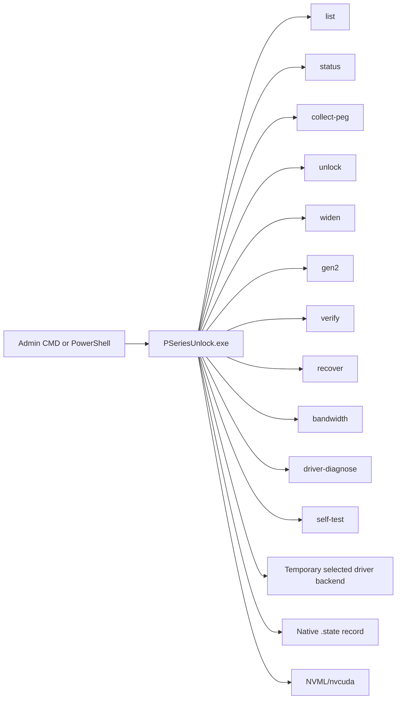

# Preliminary Original Functionality Map

This map establishes apparent functionality only. Internal implementation remains unknown.

| Command family | Documentation | Script reference | Executable reference | Apparent purpose | Hardware modification | Unknown |
|---|---|---|---|---|---|---|
| `list` | Yes | Yes | Yes | Enumerate devices/resources | No; read-only | Exact provider and result fields |
| `status` | Yes | Yes | Yes | Read PCI/NVIDIA/platform/link state | None normally; `--load-driver` loads temporary read/write backend | Full status schema |
| `collect-peg` | Only script context | Yes | Yes | Collect PEG/controller data | Designed read-only | Exact collected fields and scope |
| `unlock` | Yes | Yes | Yes | Run width/speed unlock transaction | Yes; PCI/MMIO/PNP/SBR/temporary policy operations | Internal sequence and register semantics |
| `widen` | Yes | Partial | Yes | Optimize actual width without Gen2 activation | Yes | Backend-specific behavior |
| `gen2` | Yes | Yes | Yes | Independently activate and verify Gen2 | Yes for speed/target policy | Full implementation |
| `verify` | Yes | Yes | Yes | Verify existing link/CUDA state | CUDA memory operations; no documented prepare/reset/write sequence | Verification details |
| `recover` | Yes | No direct script wrapper | Yes | Replay or compensate pending native state | Potential PCI/MMIO/PNP/resource/policy cleanup | Recovery v1-v4 implementation |
| `bandwidth` | Yes | Yes | Yes | CUDA host/device bandwidth and data validation | CUDA memory operations only; no unlock expected | Exact kernel/test implementation |
| `driver-diagnose` | Yes | No direct launcher | Yes | Collect OS, Authenticode, and CI diagnostics | No driver load or hardware write claimed | Export and parsing details |
| `self-test` | Yes | No direct launcher | Yes | Offline or synthetic validation | No hardware write claimed | Test count and implementation |

## Apparent command modes

- `--load-driver`: load a temporary selected backend.
- `--backend`: selects Seavo, BS_RCIO, or MyDrivers.
- `--bdf`: target device.
- `--target-width`: selects 8 or 16.
- `--allow-busy`: permits unlock despite GPU activity indicators.
- `--research`: read-only research collection.
- `--diagnose`: extra read-only diagnostic snapshots.
- `--auto-peg`: automatic controller/PEG bundle mode.
- `--experimental-vbios-width`: P104-specific VBIOS sequence.
- `--experimental-width-bit29`: P106-specific bit29 sequence.

## Mermaid command map

