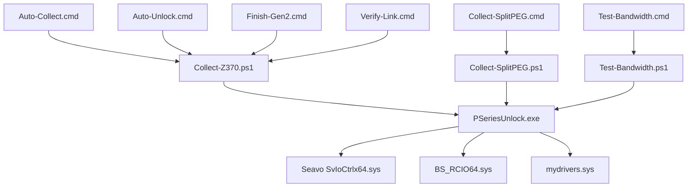

# Script Catalog

No supplied CMD or PowerShell script was executed.

## CMD entry points

| Script | Entry point | Parameters | Environment | Native invocation | Purpose | Cleanup |
|---|---|---|---|---|---|---|
| `Auto-Collect.cmd` | Batch script | Passes arguments to PowerShell wrapper | PowerShell, Windows admin | `Collect-Z370.ps1 -Bdf auto` | Launch collection | PowerShell creates a ZIP |
| `Auto-Unlock.cmd` | Batch script | Passes arguments | PowerShell, Windows admin | `Collect-Z370.ps1 -TestPegBundles -AutoPeg -Bdf auto` | Automatic unlock/collection workflow | Success removes diagnostics; failure stores ZIP |
| `Collect-SplitPEG.cmd` | Batch script | None | PowerShell, Windows admin | `Collect-SplitPEG.ps1` | Read-only split-PEG collection | Creates ZIP |
| `Finish-Gen2.cmd` | Batch script | Passes arguments | PowerShell, Windows admin | `Collect-Z370.ps1 -ResumeGen2 -Bdf auto` | Continue Gen2 without repeat width/SBR steps | Stores output ZIP on failure |
| `Verify-Link.cmd` | Batch script | Passes arguments | PowerShell, Windows admin | `Collect-Z370.ps1 -VerifyOnly -Bdf auto` | Verify existing unlocked state | Stores output ZIP on failure |
| `Test-Bandwidth.cmd` | Batch script | Passes arguments | PowerShell | `Test-Bandwidth.ps1` | Invoke CUDA bandwidth test | Writes text log and preserves exit code |

## PowerShell scripts

### Collect-Z370.ps1

- **Entry:** `param($Bdf='0000:01:00.0', [switch]$TestPegBundles, [switch]$AutoPeg, [switch]$VerifyOnly, [switch]$ResumeGen2)`
- **OBSERVED-SCRIPT:** Elevates by `Start-Process powershell.exe -Verb RunAs`.
- **OBSERVED-SCRIPT:** Requires BDF format `0000:[bus]:[device].[function]` when not `auto`.
- **OBSERVED-SCRIPT:** Calls `PSeriesUnlock.exe list`, `status`, `unlock`, `gen2`, and `verify`.
- **OBSERVED-SCRIPT:** Auto mode identifies exactly one P102/P104/P106 device from command output.
- **OBSERVED-SCRIPT:** Loads temporary drivers by native executable parameters.
- **OBSERVED-SCRIPT:** Creates platform, PnP, native-record, result, and video JSON/text files.
- **OBSERVED-SCRIPT:** Records recovered failures and full unlock success separately.
- **OBSERVED-SCRIPT:** Success deletes the diagnostic directory only under guarded path checks.
- **OBSERVED-SCRIPT:** Failure creates `collect-*.zip`.
- **Hardware writes:** `unlock`, `gen2`, and `resume` paths request hardware-changing operations. Collection/verify paths are designed not to unlock but can invoke CUDA and may write video output state.

### Collect-SplitPEG.ps1

- **OBSERVED-SCRIPT:** Elevates to administrator.
- **OBSERVED-SCRIPT:** Documents itself as read-only and calls `PSeriesUnlock.exe list --resources` plus `collect-peg --load-driver`.
- **OBSERVED-SCRIPT:** Collects board, BIOS, CPU, OS, video, and file hashes.
- **OBSERVED-SCRIPT:** Creates `collect-SplitPEG-<timestamp>` and a ZIP.
- **UNKNOWN:** Exact `collect-peg` implementation is only in the executable.

### Test-Bandwidth.ps1

- **OBSERVED-SCRIPT:** Expects `PSeriesUnlock.exe` in script directory.
- **OBSERVED-SCRIPT:** Calls `PSeriesUnlock.exe bandwidth`, optionally with `--bdf`.
- **OBSERVED-SCRIPT:** Redirects native output to a timestamped log.
- **OBSERVED-SCRIPT:** Highlights lines containing `FAILED:` or `WARNING:`.
- **OBSERVED-SCRIPT:** Preserves native exit code.
- **Hardware:** Uses CUDA memory transfer; does not claim to load a read/write driver or perform unlock/reset operations.

## Mermaid dependency graph

