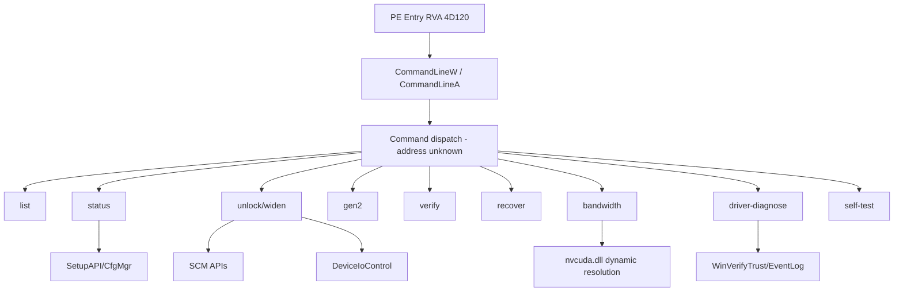

# Executable Function Map

Ghidra auto-analysis detected 1,887 functions in the mirror executable.

## Address-level evidence

The executable entry point is RVA 0x4D120 and image base 0x140000000. Ghidra function inventory has been saved under `.analysis-output/ghidra-inventory.txt`.

Addressable function inventory categories cannot yet be semantically named without xrefs. The following map separates known static evidence from future mapping work.

| Area | Evidence currently confirmed | Status |
|---|---|---|
| Console entry/command dispatch | Strings plus executable entry and KERNEL32 command-line imports | Confirmed presence; address not yet mapped |
| Native engine | Large `.text` and 1,887 functions | Unknown grouping |
| Windows I/O | Imported SetupAPI, SCM, ADVAPI32, `DeviceIoControl`, registry APIs | `CONFIRMED-STATIC` |
| NVIDIA diagnostics | Static strings `nvml.dll`, `nvcuda.dll`, NVML exports | `CONFIRMED-STATIC` |
| Recovery | Recovery strings and BCrypt hash/service/file APIs | `CONFIRMED-STATIC` |
| PCIe/PEG logic | PCIe, MMIO, split/PEG strings and likely code references | `INFERRED`, not address-mapped |
| Backend management | Backend names, device names, IOCTL-related imports | `CONFIRMED-STATIC`; exact dispatch pending |

## Mermaid evidence map

