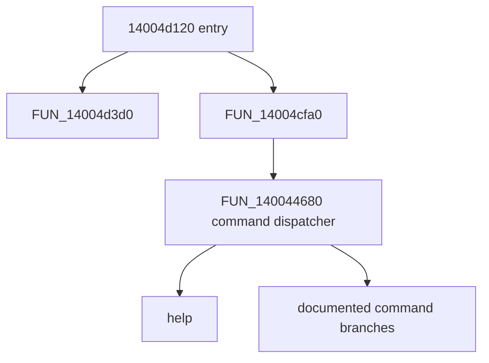

# Executable Entry and Initialization

## Entry

- Binary: `PSeriesUnlock.exe`
- SHA256: `875e0c7ce8ea4d732982eec1e44fd762d31014b16472e4161ec6df882c7ae249`
- Entry RVA: `0x4D120`
- Ghidra address: `14004d120`
- Classification: `CONFIRMED-STATIC`

Decompiled entry:

```c
void entry(void) {
    FUN_14004d3d0();
    FUN_14004cfa0();
}
```

## Initialization interpretation

The entry calls two compiler/application-runtime regions:

- `FUN_14004d3d0`: analyst cannot yet determine whether it is startup, CRT, or application initialization.
- `FUN_14004cfa0`: no semantic name or PDB-backed implementation is available.

The actual command dispatcher is `FUN_140044680`.

## Startup flow



## Unknown

- Exact CRT/application split.
- Global constructors/data initialization address.
- Main-equivalent address beyond decompiled entry call chain.
- Whether any hardware preconditions occur before command dispatch.
