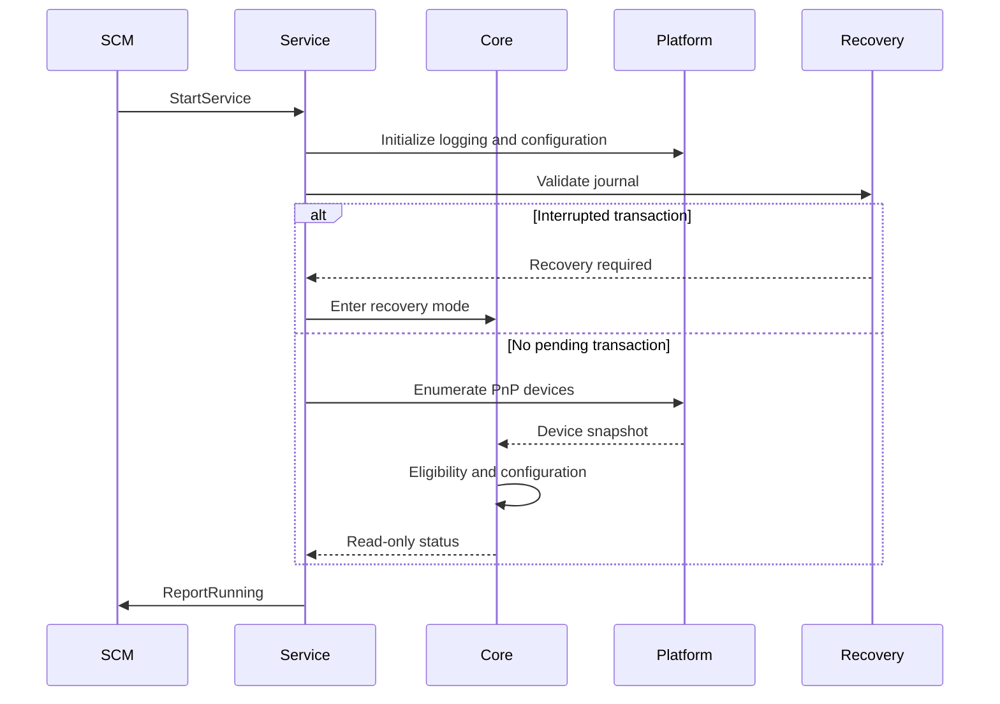

# Service Architecture

## Executables

PSeriesService.exe is the application.

PSeriesInstaller.exe only controls installation lifecycle.

## Process model

The service runs:

- in Session 0,
- independently of desktop login,
- through SCM,
- at automatic or delayed-automatic startup,
- without a visible window.

## Recommended startup mode

Automatic Delayed Start is the initial recommendation.

Reason:

- boot hardware and NVIDIA drivers may not be ready during immediate service start,
- delayed startup provides initialization retries,
- read-only discovery remains safe,
- no hardware modification occurs during service start.

Automatic startup remains required, but hardware eligibility is rechecked after PnP settle-time or event-based device arrival.

## Startup sequence

