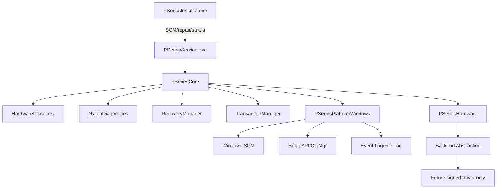
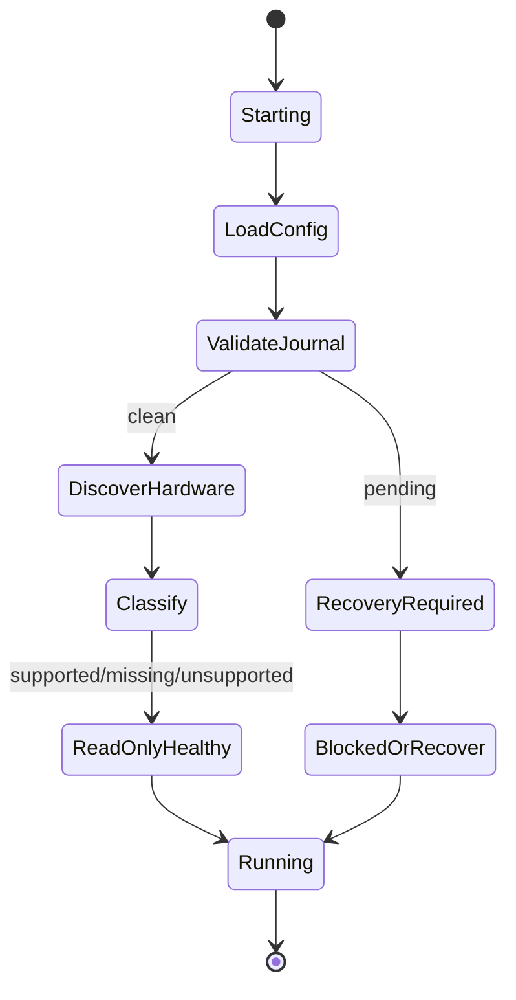
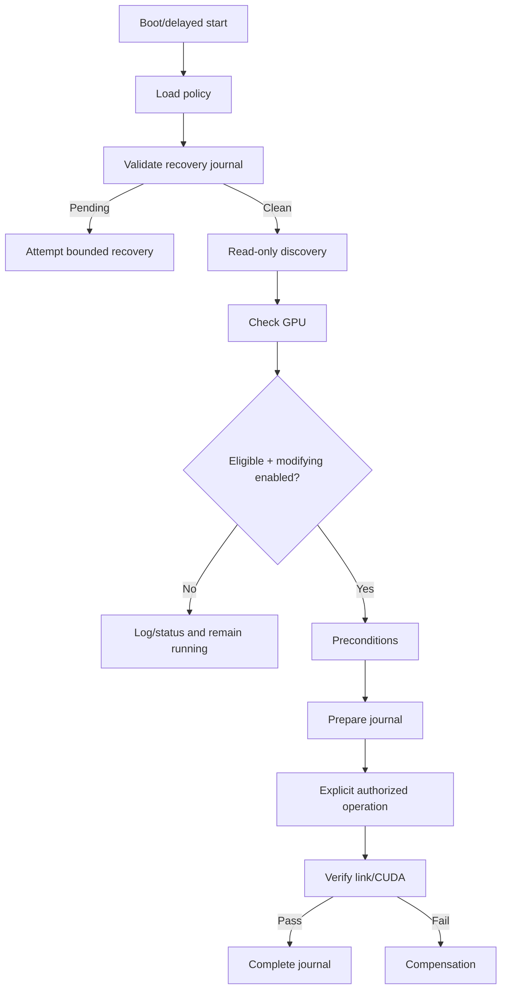

# Installer and Service Diagrams

## Entire application architecture



## Service startup



## Automatic workflow



## Uninstaller lifecycle

```mermaid
flowchart TD
    User[User action] --> Elevate[Administrator elevation]
    Elevate --> StopOps[Stop new hardware operations]
    StopOps --> Pending{Pending transaction?}
    Pending -->|Yes| Preserve[Preserve journal and report]
    Pending -->|No| StopSvc[Stop PSeriesService]
    StopSvc --> RemoveSvc[Delete service registration]
    RemoveSvc --> RemoveFiles[Remove binaries]
    RemoveFiles --> Done[Report completion]
    Preserve --> StopSvc
*** End Patch
