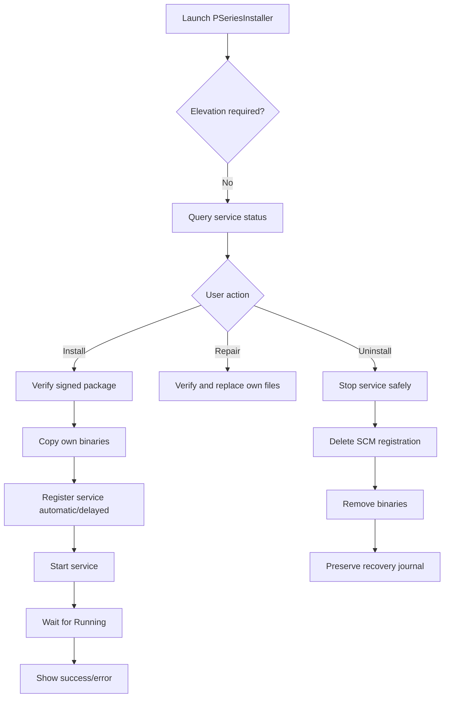

# Installer Architecture

## Technology decision

Recommended initial installer:

- WiX Toolset MSI for install, uninstall, upgrade, repair, and SCM registration.
- PSeriesInstaller.exe as a small native Win32 status/elevation UI.

WiX is preferable to a custom installer for service registration, transaction rollback, MSI repair, upgrade codes, and uninstallation.

Native Win32 is preferable to Qt for the two-to-four installer actions.

## Installer actions

- Install
- Uninstall
- Repair
- Display status

## Elevation

The GUI requests elevation only for service installation/removal or repair.

Read-only status and version can be viewed without elevation.

## Flow

