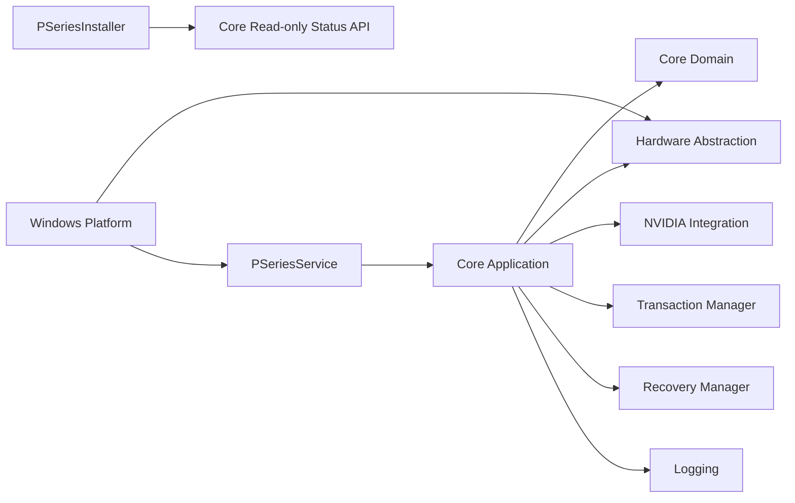

# Core Engine Architecture

## PSeriesCore layers

- Domain: hardware identity, link state, device eligibility, operation policy.
- Application: discovery, workflow, validation, verification.
- Transactions: prepare/commit/rollback state machine.
- Recovery: persistent journal and compensation.

## Module dependencies

## Modules

- HardwareDiscovery
- PciTopology
- PciDiagnostics
- BackendManager
- NvidiaDiagnostics
- AutoPegEngine
- TransactionManager
- RecoveryManager
- Logger
- ConfigurationManager

Core logic must not depend on Win32 UI or installer code.
