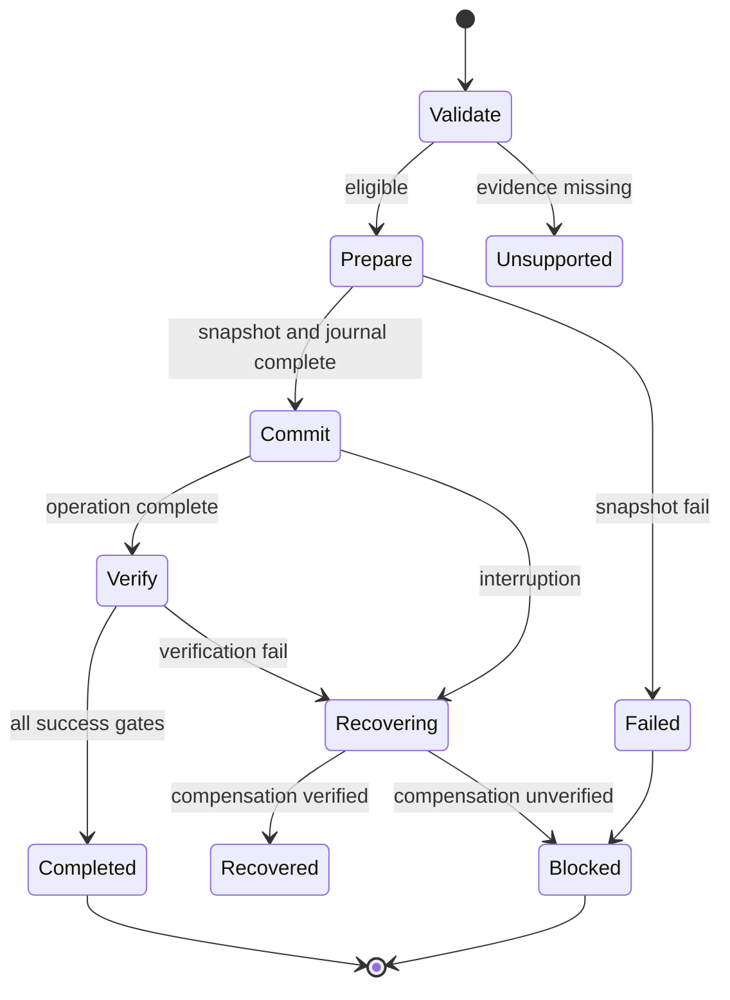

# Recovery Architecture

## Separate states

Software state and physical hardware state are separate:

- journal state,
- resource snapshot,
- policy snapshot,
- actual PCI link state,
- CUDA validation state,
- completed/compensated/failed status.

## Journal requirements

- schema version,
- unique transaction ID,
- boot GUID,
- device identity,
- upstream identity,
- resource identity,
- before-state hash,
- intended compensation,
- phase,
- status,
- checksum,
- migration history.

## Transaction state machine

Restoring software state is not defined as physical restoration.
